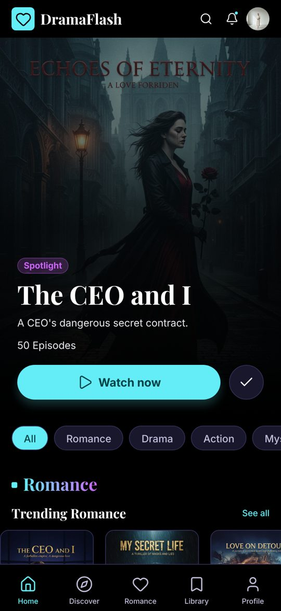
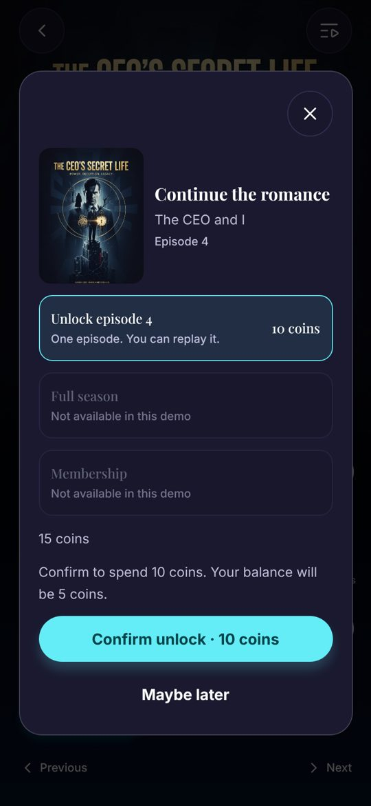
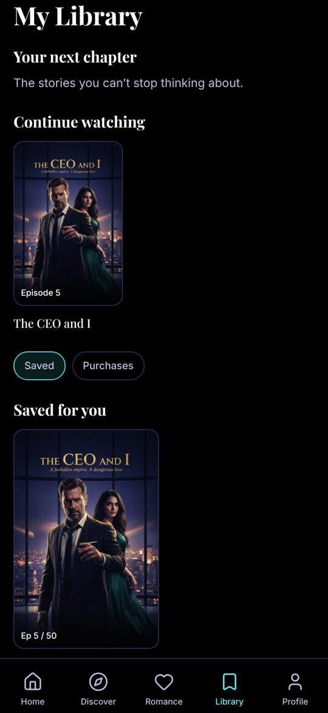
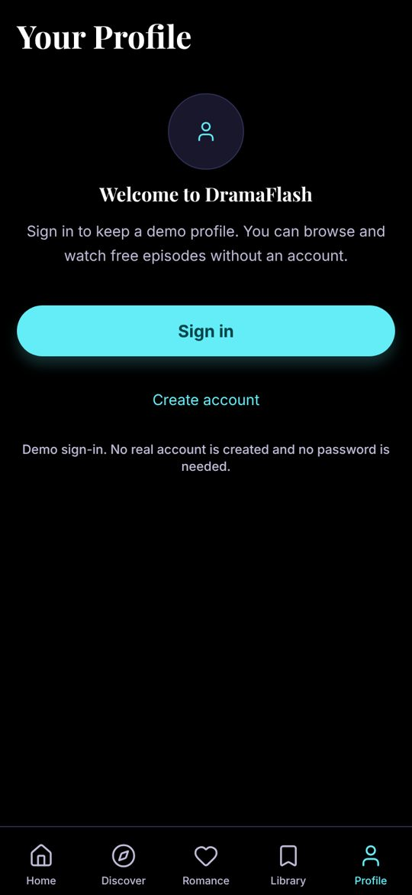

# DramaFlash

**A short-drama streaming prototype built with React Native and Expo.**

DramaFlash was developed for **TargetVideo's Mobile App Developer take-home assignment (Option A)**. It demonstrates the core viewing journey: discover a series, open an episode, reach a cliffhanger, and unlock the next episode using demo coins.

<p align="center">
  
  
  
  
</p>

## Try DramaFlash

| Experience      | Link                                                                                                            | Notes                                                                                     |
| --------------- | --------------------------------------------------------------------------------------------------------------- | ----------------------------------------------------------------------------------------- |
| **Android APK** | **[Download v1.0.0 demo](https://github.com/DMihail/DramaFlash/releases/download/v1.0.0-demo/app-release.apk)** | Standalone APK; does not require Expo Go or Metro.                                        |
| **Web demo**    | **[Open DramaFlash](https://dramaflash--dramaflash-demo.expo.app/)**                                            | Hosted on EAS Hosting. Its deployed version may differ from the latest repository commit. |
| **Source code** | [GitHub repository](https://github.com/DMihail/DramaFlash)                                                      | React Native / Expo / TypeScript.                                                         |

**iOS:** Source code supports iOS, but no public iOS installation or TestFlight distribution is provided. The web demo is available in a mobile browser.

### Two-minute walkthrough

1. Browse **Home** and **Discover**, then open **The CEO and I**.
2. Open the player. Episodes **1–3 are free**; Episode **4 is locked**.
3. Select **Unlock** and confirm the **10-coin** charge. A new wallet starts with **15 demo coins**.
4. Continue to another locked episode. Use **Get coins** to add a simulated coin pack when your balance is insufficient.
5. Explore **Library** for saved series, Continue Watching and unlocked episodes.
6. Open **Profile** and try demo sign-in. Refresh or restart to see locally saved progress.

To start over, clear the site's storage in your browser or clear the Android app's data. This resets locally stored demo progress.

## What's included

- **Home and discovery:** Featured series, genre rails, search, and category filtering.
- **Series details:** Artwork, synopsis, cast, and an episode list showing free and locked states.
- **Player prototype:** Episode artwork, playback-like controls, previous/next navigation, and a cliffhanger lock experience.
- **Coin unlocking:** A confirmation sheet, simulated coin store, balance updates, and protection from repeat charges.
- **Personal library:** Saved titles, watching progress, and unlocked episodes, retained across restarts.
- **Guest and demo profiles:** Simulated sign-in flows without real credentials or accounts.
- **UI states:** Loading, empty and retry states driven by a local mock API.

## Important scope and limitations

This is an **interactive product prototype**, not a production streaming service.

- **Video:** The player displays episode artwork. No video files or real streaming are included.
- **Payments:** Coins and top-ups are simulated. No payment is taken.
- **Authentication:** Provider and email sign-in flows are demonstrations, not real account creation or provider authentication.
- **Backend:** Series data is served by a local mock API. There is no hosted backend or server-side entitlement service.
- **Subscriptions, VIP and season offers:** These may be visible as unavailable options, but are not implemented purchases.

## Engineering approach

| Area               | Implementation                                                     |
| ------------------ | ------------------------------------------------------------------ |
| Application        | Expo SDK 58, React Native 0.88, TypeScript (strict)                |
| Navigation         | Expo Router with typed routes                                      |
| Shared state       | Zustand stores for wallet, library and demo session                |
| Native persistence | `react-native-mmkv` v4 with Nitro Modules                          |
| Web persistence    | `localStorage` behind the same storage interface                   |
| UI                 | Reusable React Native components, responsive layouts, Lucide icons |
| Quality            | ESLint, Prettier, TypeScript, Jest, Expo Doctor; Maestro E2E flows |
| Distribution       | Android APK via GitHub Releases; web via EAS Hosting               |

Business rules such as episode access and coin deductions live in `src/domain/`, separate from screens. Wallet changes are written and checked before the updated value is shown, and repeated unlock taps are guarded against duplicate charges. Stored records have validation and error states. The demo wallet is **local to each device** and is not a secure, server-authoritative payments implementation.

For a production service, wallet balances, purchases, and entitlements would be validated and enforced on a backend, with platform purchase verification.

## Run locally

### Requirements

- Node.js **22.22.0** (`.nvmrc`)
- npm **11.19.0**
- Android Studio / Android SDK for Android builds
- Xcode for iOS Simulator builds (macOS)

```bash
nvm use
npm install --global npm@11.19.0
npm ci
```

### Development

```bash
npm run start          # Development Metro server
npm run web            # Browser development server
npm run android:build  # Compile and install an Android development build
npm run ios:build      # Compile and install an iOS Simulator development build
```

The native app uses MMKV and Nitro Modules, so **Expo Go is not supported**. Install a development build before attempting to open it from Metro.

### Validation

```bash
npm run validate       # ESLint, Prettier, TypeScript, Jest and Expo Doctor
npm run export:web     # Production web export with variant check
```

For Maestro E2E tests, install the Maestro CLI, start an emulator and a development build, then run:

```bash
npm run e2e
```

The repository includes Jest unit/integration tests and Maestro YAML flows. GitHub Actions runs the standard validation suite on PRs and pushes to `main`; it does not run an emulator by default.

## Build and deploy

### Android demo APK

The shared Android build is attached to the **[v1.0.0 demo release](https://github.com/DMihail/DramaFlash/releases/tag/v1.0.0-demo)**. For a new EAS preview build:

```bash
npx eas-cli@latest build --platform android --profile preview
```

A new APK must be installed and tested separately; updating the source repository does not update an already published APK.

### Web

```bash
npm run export:web
npx eas-cli@latest deploy --alias dramaflash-demo
```

The production export sets `APP_VARIANT=production` and checks generated JavaScript bundles to prevent accidental publication of a development variant. Development-only wallet and library reset routes are disabled in production.

## Project structure

```text
src/
  api/         Local mock API
  app/         Expo Router routes
  components/  Shared UI
  data/        Mock catalog and story content
  domain/      Pure business rules
  features/    Feature screens and view models
  storage/     MMKV / browser persistence
  stores/      Zustand state
  theme/       Design tokens and typography
tests/
  e2e/maestro/ Native E2E test flows
  ...          Unit and integration tests
deliverables/
  screenshots/ UI previews
  DramaFlash_Demo.mp4
```

## Design assets and attribution

The posters, stills and cast images were derived from the **`FLASH.svg` design reference supplied for the assignment** and are used for this evaluation prototype. Rights for broader reuse or distribution have not been independently verified. Icons use [Lucide](https://lucide.dev); the project uses Inter and Playfair Display fonts via Expo Google Fonts.

---

**Created for the TargetVideo Mobile App Developer technical assessment.**
